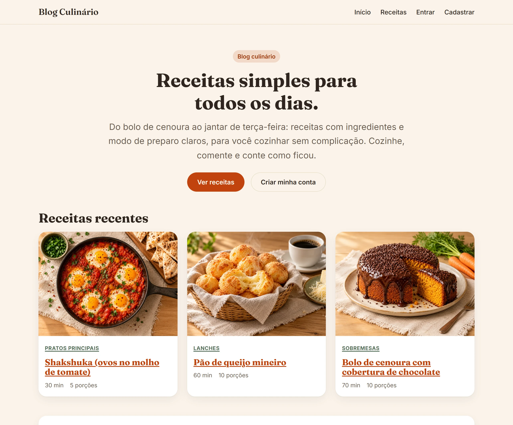

# 🍲 Blog Culinário | Django Recipe Blog for Learning Web Development

[Português (Brasil)](README.md) · **English**


[](https://github.com/ryanvmorais/django-blog-culinario/actions/workflows/ci.yml)


This repository contains a **multi-page recipe blog in Django** (Blog Culinário), built as educational material. It is not (just) a recipe site: it is a reference for anyone learning to build a complete web application in Python, with **domain modeling**, **built-in authentication** and **applied security**, going beyond the basic tutorial CRUD. The site itself and the code names (`Receita`, `Categoria`, `Comentario`) are in Brazilian Portuguese, the language of the course this project belongs to.

### 🎯 Project Goal:

Show how the pieces of a real Django application fit together (modeling, views, templates with inheritance, forms, a customized admin, image upload and security) in code you can read from top to bottom and understand the reason behind each decision, not just the "how".

---

### 📚 What will you learn from this project?

This project was structured to consolidate core software engineering pillars:

- **Domain Modeling:** real relationships between `Receita` (recipe), `Categoria` (category), `Tag` and `Comentario` (comment), with an explicit `on_delete` policy for each one.
- **Two View Styles:** function-based (`nucleo`) and class-based (`receitas`), side by side, so you can compare the two approaches.
- **Custom Design System:** template inheritance (`base.html` + blocks) and plain CSS in `static/css/tokens.css`, with no frontend framework and no build step. Fonts are hosted in the project, the light and dark themes follow the system using color variables only, and a visual catalog lives in `docs/design-system.html`.
- **Built-in Authentication:** `django.contrib.auth` with no external library, with a per-IP limit on login attempts.
- **Applied Security:** honeypot and time-trap on the comment form, image upload validation, secrets kept out of the code.
- **Audited Interface:** accessibility checked in a real browser (axe-core, keyboard, contrast, dark theme) and guarded by tests, starting from spec 008.
- **Automated Quality:** a `pytest` test suite and a CI pipeline that runs the same quality gate used locally.

---

### 🧠 Implementation Guide (The Logic Behind the Code):

For beginners, the biggest challenge is not memorizing Django commands but understanding how to **assemble the reasoning** of a real application. Here are the pillars behind this project:

1. **Apps by Domain, not by Layer:** `nucleo` (institutional pages), `receitas` (the main domain) and `usuarios` (authentication). Each app fits in a sentence, which makes it easy to know where to make a change.
2. **Per-Environment Configuration:** `settings/` is a package, not a single file. `base.py` holds what never changes; `dev.py` and `prod.py` only override what is specific to the environment. It is the pattern that avoids the classic "I forgot to change DEBUG before deploying".
3. **A Database Chosen on Purpose:** SQLite not out of laziness, but by decision: zero configuration for whoever clones the repo, since the goal is to learn Django, not to administer a database.
4. **Visual Identity from Scratch:** a small design system in `static/css/tokens.css` (colors, typography and spacing as CSS variables) keeps the project 100% focused on Python, without hiding how a front end is put together.
5. **Layered Security:** per-IP attempt limits (login and comments) and a honeypot + time-trap on the comment form, implemented from the findings of a real security audit, not from speculation.
6. **Spec-Driven Development:** every new feature is born in `specs/` before the code, with requirements, design and tasks, and approval before moving to the next phase.

---

### 🛠️ Technologies and Tools:

To give you the best learning experience, the project uses the following technologies:

| Tool | Description |
| :--- | :--- |
| **Python 3.12+** | The project's base language. |
| **Django 6.1** | "Batteries included" web framework, for all the logic, the ORM and the admin. |
| **SQLite** | Relational database: one file, zero configuration. |
| **uv** | Dependency and virtual environment manager, with a reproducible lockfile. |
| **Pillow** | Processes and validates the recipes' cover images. |
| **django-environ** | Reads `SECRET_KEY` and `DEBUG` from the environment instead of leaving them in the code. |
| **WhiteNoise** | Serves static files in production without needing Nginx or a CDN. |

The quality tools (Ruff, Black, Mypy and Pytest) are in [Quality and tests](#quality-and-tests). For the reasoning behind each choice (and the alternatives that were discarded), see [docs/stack.md](docs/stack.md).

---

### ⚙️ How to run the project locally:

**Prerequisites:** [Python 3.12+](https://www.python.org/downloads/) and [uv](https://docs.astral.sh/uv/getting-started/installation/), which creates and manages the virtual environment automatically. To check, run `python --version` and `uv --version`.

1.  **Clone the repository:**
    ```bash
    git clone https://github.com/ryanvmorais/django-blog-culinario.git
    cd django-blog-culinario
    ```
2.  **Install the dependencies:**
    ```bash
    uv sync
    ```
3.  **Create the database tables:**
    ```bash
    uv run python manage.py migrate
    ```
4.  **Start the server:**
    ```bash
    uv run python manage.py runserver
    ```

Open `http://127.0.0.1:8000/`. No environment variable is needed to run locally; see `.env.example` if you want to customize something.

Want to see the site with sample recipes without signing anyone up? Run `uv run python manage.py semear_dados_demo`: it creates fictional recipes, covers and comments (development only, and without duplicating them if you run it again).

> ⚠️ **Note about the Admin:** want a user to access `/admin/`? Run `uv run python manage.py createsuperuser` and follow the instructions in the terminal.

---

### Quality and tests

The project runs an automated test suite (`pytest`) and a quality gate before any commit:

```bash
# Lint + import order
uv run ruff check .

# Formatting
uv run black --check .

# Type checking
uv run mypy .

# Tests
uv run pytest
```

The same gate runs automatically in CI (`.github/workflows/ci.yml`) on every PR and every push to `main`, on Python 3.12 (the project's floor) and 3.14. Every Monday, `.github/workflows/pip-audit.yml` audits `uv.lock` for CVEs. The `.github/workflows/lighthouse.yml` audits the public pages (accessibility, SEO, contrast, touch targets, CLS and weight) on mobile and desktop on every PR that changes the interface and on every push to `main`; it does not block the merge, because Lighthouse varies on a shared server. For the map of each technology in the stack (what it is, why it was chosen, what to study), see [docs/stack.md](docs/stack.md). For the specification of each feature, see [specs/](specs/). For the details of architecture and conventions, see [CLAUDE.md](CLAUDE.md).

---

### 📋 Practice activities (Evolution Challenges):

To exercise what you learned and master Django, try implementing these new features:

1. **🔍 Filter by Preparation Time:** add a filterable `tempo_de_preparo` (preparation time) field to the recipe list.
   - **What You Learn:** `QuerySet.filter()` combined with a search form.
2. **🎲 Random Recipe:** create a route that leads to a published recipe chosen at random.
   - **What You Learn:** Django's `order_by("?")` and the performance limits of that approach on a larger database.
3. **💬 Comment Pagination:** paginate the comments of a recipe that has many of them.
   - **What You Learn:** `Paginator` applied to a related queryset (not to the whole page), and how to adjust the template to paginate only one section.
4. **🐘 Switch the Database:** replace SQLite with PostgreSQL in a separate environment.
   - **What You Learn:** how `DATABASES` isolates the project from the physical database: the rest of the code does not change a single line.

---

### 🧭 Keep practicing:

This project is part of a Python study path. After this one, try:

- **[webvigil](https://github.com/ryanvmorais/webvigil):** a web vulnerability scanner (DAST) in Python, to see security from the other side.
- **[Dynamic Portfolio with Django](https://github.com/ryanvmorais/django-fullstack-portfolio):** another Django project, focused on advanced security (honeypot, rate limit, CSP) and query optimization.

See all the projects and videos on the channel at [aprenda-com-ryan-morais](https://github.com/ryanvmorais/aprenda-com-ryan-morais).

---

### 💡 Got a question or a suggestion?

Did you find something that could be more didactic, have trouble with a setup step, or think of an improvement that would make this project even more useful as a reference? I'm here to help!

- **Open an [Issue](https://github.com/ryanvmorais/django-blog-culinario/issues):** describe your question or suggestion. It is the best way to build a solid reference for the community and to help other developers who may have the same question.
- **Contribute code:** want to propose an improvement? See the step-by-step in [CONTRIBUTING.md](CONTRIBUTING.md).
- **Send me an email:** if you prefer something more private, write to [**contato@ryanmorais.com.br**](mailto:contato@ryanmorais.com.br).

I will be very happy to follow your progress with the Django framework and to receive your feedback to keep improving the quality of this study material! 🤝

---

### ⚖️ License

This project is under the **MIT License**. That means you can use, copy and modify the code freely, including in your own projects. For more details, see the [LICENSE](LICENSE) file.
